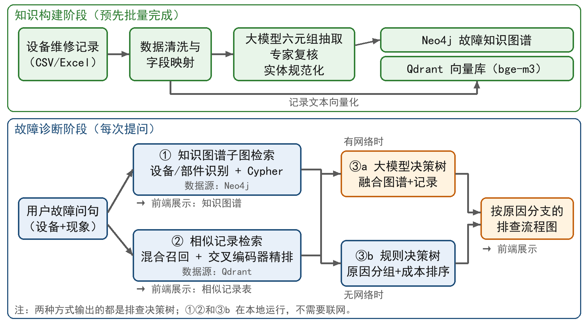

# 毕业论文（设计）开题报告

题目：基于知识图谱增强大模型的产线故障诊断系统

## 一、选题的依据及意义

### （一）选题依据

汽车零部件制造对生产节拍和设备稼动率要求很高。机加工车间的加工中心、清洗机、机械手等设备长时间连续运行，关键设备一旦停机，往往会造成整条产线停线。设备发生故障后，维修人员要根据报警信息和故障现象，凭经验判断故障部位和原因，再逐项排查处理。排查效率很大程度上取决于个人经验：经验丰富的维修人员通常能较快定位问题，新员工则需要反复试错，耗时较长。

企业在长期生产中以电子表格等形式积累了大量设备维修记录，每条记录包含设备、故障现象、故障原因和处理措施等信息，是宝贵的维修经验。但这些记录的利用存在三方面问题：一是以非结构化短文本为主，表述口语化，同一部件、同一故障常有多种写法；二是现有台账只能按关键词查找，难以按“设备—部件—故障—原因—措施”的因果关系进行综合分析；三是查询结果是零散的原始记录，维修人员仍需自己归纳排查顺序。大量历史经验因此没有得到有效复用。

知识图谱以实体和关系的形式组织知识，能清晰表达设备、部件、故障、原因和措施之间的关联，便于追溯和可视化，在制造领域已有较多应用[1]。但知识图谱本身不擅长理解自然语言提问，也不能直接给出综合性的处置建议。以大语言模型为代表的生成式人工智能具有很强的语言理解与生成能力，但通用大模型缺少企业私有的设备知识，容易生成看似合理却与事实不符的内容，即“幻觉”问题[2]，直接用于工业现场存在风险。检索增强生成（Retrieval-Augmented Generation，RAG）在生成前先检索外部知识，用检索结果约束模型输出，是缓解这一问题的主要途径[3]；用知识图谱中的结构化知识增强大模型，也已成为研究热点[4]。

基于上述背景，本课题依托某汽车零部件企业机加工车间的真实维修数据，设计并实现一个基于知识图谱增强大模型的产线故障诊断系统：利用大模型从历史维修记录中抽取故障知识，构建故障知识图谱；诊断时同时检索知识图谱子图和相似历史记录，把二者作为证据交给大模型，生成按原因分支、先易后难的排查流程。

### （二）研究意义

（1）**理论与技术意义**。探索知识图谱和向量检索两路证据共同增强大模型的融合方式，并在真实工业数据上通过消融实验，定量分析知识图谱对大模型生成质量的贡献，为知识图谱增强大模型在工业故障诊断中的应用提供参考。

（2）**实践意义**。系统把分散在表格中的维修经验沉淀为可检索、可视化、可追溯的知识资产，帮助维修人员快速了解同类故障的历史原因和处理方法，缩短故障定位时间，降低对个人经验的依赖，也可用于新员工培训。系统部署在企业内网，大模型调用企业内部的模型服务，生产数据不出企业内网；无网络时仍可用规则决策树完成诊断，符合企业的数据安全和现场使用要求。

## 二、国内外研究现状及发展趋势（含文献综述）

### （一）设备故障知识图谱研究现状

知识图谱在制造领域的应用已从语义检索逐步扩展到决策支持。陶家琦等[1]将制造领域知识图谱的应用归纳为语义关联、定性决策和综合决策三个层次。在设备故障诊断方面，刘晶等[5]针对小样本工况构建设备故障知识图谱，利用元学习进行链接预测，实现了故障诊断和相似故障查询；周彬等[6]从冶金设备点检文档中抽取故障事件，构建因果知识图谱并估计因果效应，用于挖掘故障根因；陈宏等[7]采用改进的BERT-BiLSTM-CRF模型抽取故障实体，结合六元组本体在Neo4j中构建风电机组故障知识图谱，并开发了诊断系统；邢雪琪等[8]基于商用飞机故障隔离手册构建知识图谱，结合文本匹配推荐维修方案。这些研究表明，知识图谱能有效组织故障知识，并支持推理和方案推荐。但图谱构建大多依赖人工设计的规则或专门训练的抽取模型，成本较高；用户交互多为关键词或模板查询，对自然语言提问的支持有限。

### （二）维修文本知识抽取研究现状

维修记录篇幅短、表述口语化，缩写和设备编号多，是图谱构建的主要难点。田嘉鹏等[9]针对电力设备故障文本提出实体识别方法，用于故障案例图谱构建；党小超等[10]基于矿井提升系统的点检维修记录自建数据集，研究故障实体关系抽取。这类深度学习方法通常需要大量人工标注数据，迁移到新的设备领域时成本较高。大模型出现后，借助提示词进行零样本或少样本抽取成为新的途径。夏江镧等[11]综述了基于大语言模型的实体关系抽取方法；Okazaki等[12]利用本体引导的大模型，从多条产线的失效模式与影响分析（FMEA）表单中抽取知识，构建统一的知识图谱，再用图神经网络识别故障原因。

### （三）检索增强生成与知识图谱增强大模型研究现状

Lewis等[3]提出RAG方法，将稠密检索器与生成模型结合，在知识密集型任务上取得了更好的效果。在检索器方面，Karpukhin等[13]提出的稠密段落检索（DPR）效果明显优于传统的BM25方法；Chen等[14]提出的BGE-M3模型同时支持稠密、稀疏和多向量检索，适用于中文等多种语言。Gao等[15]和刘雪颖等[16]分别对RAG的范式、关键技术和评测方法进行了综述。在多路检索结果融合方面，Cormack等[17]提出的倒数排名融合（RRF）方法被广泛采用。

在知识图谱与大模型融合方面，Pan等[4]提出了知识图谱增强大模型、大模型增强知识图谱以及二者协同的三类框架；Edge等[18]提出GraphRAG，由大模型从文档中构建实体图谱并生成社区摘要，用于回答面向整个语料库的全局性问题；Peng等[19]把GraphRAG的流程归纳为图索引、图引导检索和图增强生成三个阶段；冯拓宇等[20]综述了大模型增强的知识图谱问答方法。在应用方面，张鹤译等[21]融合大模型与知识图谱，构建了中医方剂领域的问答系统；王永等[22]由大模型生成Cypher查询语句，实现了高校科研管理问答系统。

### （四）大模型在工业故障诊断中的应用

近两年，大模型开始进入工业运维领域。程玉杰等[23]以“故障元”为基本单元构建航空电子装备故障知识图谱，将图谱推理与子图增强的大模型推理交叉校验，提高了诊断准确度；邓养吾等[24]设计领域指令模板对大模型进行微调，用于生成电力故障抢修方案；Bahr等[25]把FMEA数据构建为知识图谱并生成向量表示，提出了知识图谱增强的RAG框架；Ojima等[26]针对已有的汽车故障知识图谱优化Graph RAG的查询生成流程，提升了问答质量。

### （五）发展趋势与存在的问题

综合来看，该领域呈现以下趋势：（1）知识图谱构建由人工为主转向大模型辅助的自动化构建；（2）检索方式由单一的图谱查询或向量检索转向多路混合检索；（3）输出形式由开放式问答转向维修方案、排查流程等结构化的决策结果；（4）出于数据安全考虑，开源大模型的本地私有化部署受到重视。

同时还存在以下不足：（1）面向产线维修短文本的图谱自动构建质量不稳定，实体同义异写问题突出，仍需规范化处理和人工把关；（2）多数系统停留在问答层面，能输出可执行、可溯源排查流程的研究较少；（3）缺少基于真实工业数据、定量评估知识图谱给大模型带来多少增益的研究。本课题针对以上问题开展研究。

## 三、本课题研究内容

本课题以某汽车零部件企业机加工车间的设备维修记录为数据基础，研究内容包括以下五个方面。

（1）**故障知识图谱构建**。对2023—2025年约1.5万条维修记录进行清洗、字段映射和脱敏处理，全部记录向量化后用于相似记录检索；以经专家复核的2023年记录为主体构建故障知识图谱，并视进度将2024—2025年记录补充进图谱。设计包含区域、设备、部件、故障现象、原因、处理措施六类实体和五类关系的故障本体，每条关系保留来源记录编号，保证知识可追溯。区域和设备直接取自记录字段，部件、故障现象、原因和措施由大模型在规则化提示词的约束下抽取，组成六元组；再通过规则校验、专家复核和实体规范化（同义合并、别名映射）提高抽取质量，最后导入Neo4j图数据库。

（2）**双路证据检索**。一路是知识图谱子图检索：识别问句中的设备（工位）、部件和故障现象，用Cypher查询相关的“设备—部件—故障—原因—措施”链路；针对精确匹配容易查不到结果的问题，研究基于图谱实体词典的识别方法和按字面覆盖度加权的打分方法。另一路是相似记录检索：维修记录经BGE-M3向量化后存入Qdrant向量数据库，用字面与向量相似度加权的混合打分召回候选记录，再用交叉编码器精排。

（3）**知识图谱增强的排查流程生成**。把知识图谱子图中的原因和措施分支与精排后的相似记录组织成结构化上下文，设计提示词和JSON格式的流程描述约束，由大模型生成按原因分支、先易后难排序的排查决策树，每一步给出依据和证据来源。无网络时改为按规则生成决策树；同时对大模型输出进行格式和内容校验，校验不通过时也改用规则决策树，保证系统始终有可用结果。

（4）**系统设计与实现**。采用前后端分离的B/S架构，实现故障问答与多轮追问、三段式诊断结果展示（知识图谱、相似记录表、排查流程图）、知识图谱可视化与编辑回滚、维修数据导入、模型与提示词在线配置等功能。

（5）**实验评估**。从图谱构建质量、检索效果、排查流程生成质量和系统响应性能四个方面开展实验，并通过消融实验分析知识图谱对大模型生成结果的影响。

## 四、本课题研究方案

### （一）技术路线

本课题的技术路线如图1所示，分为知识构建和故障诊断两个阶段。

知识构建阶段预先批量完成：维修记录经清洗和字段映射后，一方面由大模型抽取六元组，经专家复核与实体规范化后导入Neo4j，形成故障知识图谱；另一方面将原始记录文本向量化后存入Qdrant。故障诊断阶段在每次提问时执行：用户输入故障问句后，系统依次完成三步：①检索知识图谱子图，以图形方式展示；②检索相似历史记录，以表格方式展示；③生成按原因分支的排查流程图。其中①②只依赖本地部署的Neo4j、Qdrant和嵌入模型，不需要联网。第③步输出的都是排查决策树，生成方式由有无网络决定：系统先探测能否连上大模型服务，有网络时，把图谱节点和精排后的前6条记录交给大模型，由大模型融合两路证据生成排查决策树（③a）；无网络时（包括调用中途断网或超时），用规则生成决策树（③b）。规则生成把检索到的记录按原因分组，按“相关度×出现次数”选出主要原因，再按处理成本由低到高排序。另外，若大模型返回的内容未通过格式校验，也改用规则决策树，保证诊断始终有结果。

### （二）关键技术方案

（1）**知识抽取与图谱存储**。提示词中明确各字段的定义和难例规则，例如“换刀”“移动”等动作词不能作为部件，拆装钣金只是维修过程而不是故障部件，并要求模型只输出JSON。对抽取结果检查空值、字段长度、“故障现象与原因相同”等问题，经人工复核后入库。图谱采用Neo4j属性图模型存储，导入时用MERGE语句去重，并在关系上记录来源行号和年份。

（2）**混合检索**。用BGE-M3[14]生成1024维稠密向量，候选记录的综合得分按式（1）计算：

$$s = \alpha \cdot s_{\mathrm{lex}} + (1-\alpha) \cdot s_{\mathrm{vec}} \tag{1}$$

式中，slex为问句与记录之间的字面覆盖度（以二元字组为单位，按逆文档频率加权），svec为向量余弦相似度，α为权重系数，通过实验确定（前期实验取0.65），并与RRF[17]等融合方法进行对比。召回结果再由bge-reranker交叉编码器精排。

（3）**排查决策树生成**。大模型通过OpenAI兼容接口调用，可对接企业内部的大模型服务，也支持用Ollama部署Qwen3等开源模型[27]；采样温度设为0以保证输出稳定，并设置调用超时，超时或无网络时切换为规则决策树。提示词要求模型只能使用证据中出现的设备、部件和处理动作，并按“出现频次高、处理成本低的原因优先”排列分支。输出为JSON格式的决策树描述，包括故障问题、最可能原因、通用前置步骤、原因分支及处置步骤、验证条件等字段。规则决策树输出同样的格式，前端统一用Mermaid渲染为流程图。

（4）**系统架构**。后端用FastAPI提供REST接口和流式（SSE）接口，用LangGraph编排检索、追问、诊断等路由，会话记录保存在SQLite中；前端用React和Vite开发，用Cytoscape.js和ECharts实现知识图谱可视化，用Mermaid绘制排查流程图。

### （三）实验方案

实验一：图谱构建质量。对六元组按设备分层随机抽取200条，人工判定各字段是否正确，统计字段准确率和整条准确率。

实验二：检索效果。采用留一法：以每条测试记录的故障描述作为问句，以同一设备、同一部件的其他历史记录作为相关结果，用Hit@1、Hit@5、平均倒数排名（MRR）和前5精度（P@5）评价字面检索、向量检索、加权融合、RRF融合等方案。前期已在2023年数据中抽样300条（有效284条）完成初步实验，加权融合方案的Hit@5为93.7%，MRR为0.860。图谱检索部分对比精确匹配方法与改进方法的命中率和无结果率。

实验三：排查流程生成消融实验。选取100条测试问句，设置五组对比（见表1）。生成时屏蔽测试问句对应的原始记录及其图谱链路，防止答案泄漏。评价指标包括根因命中率、措施命中率、幻觉率（流程中出现证据以外的部件或动作的比例）、输出格式合法率和生成耗时；另请维修人员对其中30个样例按1～5分进行人工评分。

表1 排查流程生成消融实验分组

| 组别 | 提供给大模型的证据 | 说明 |
|---|---|---|
| G0 | 无（不使用大模型） | 基于规则的决策树，作为基线 |
| G1 | 仅用户问句 | 检验大模型自身的知识 |
| G2 | 问句＋相似记录 | 常规RAG |
| G3 | 问句＋知识图谱子图 | 仅用图谱增强 |
| G4 | 问句＋知识图谱子图＋相似记录 | 本课题的完整方案 |

其中，G2与G4、G1与G3的差异分别反映了在有、无相似记录两种情况下，知识图谱给大模型带来的增益。

实验四：性能测试。统计知识图谱检索、相似记录检索与精排、大模型生成等各阶段的平均耗时和95分位耗时。

### （四）可行性分析

（1）**数据可行性**。已获得三年的真实维修记录，完成了2023年记录的六元组抽取与专家复核，构建的故障知识图谱约有7000个实体节点、2万余条关系。

（2）**技术可行性**。Neo4j、Qdrant、BGE-M3、Qwen3、FastAPI、React等均为成熟的开源技术，资料丰富；前期已搭建原型系统，并完成了初步的检索实验。

（3）**硬件可行性**。Neo4j、Qdrant和嵌入模型可在普通工作站上运行；大模型调用企业已有的模型服务，不需要额外的显卡。

（4）**数据安全**。论文和演示只使用脱敏后的数据，设备编号、区域名称等信息均做替换处理。

## 五、研究目标、主要特色及工作进度

### （一）研究目标

（1）构建机加工车间设备故障知识图谱，六元组人工抽检的整条准确率不低于90%；

（2）相似记录检索的Hit@5不低于90%；

（3）完整方案（G4）的根因命中率和措施命中率高于各对照组，幻觉率低于仅使用大模型的G1组；

（4）完成一套可现场演示的故障诊断系统，诊断结果按知识图谱、相似记录、排查决策树分阶段返回，无网络时仍能给出规则决策树。

### （二）主要特色

（1）**双路证据增强**。同时利用知识图谱中结构化的因果链路和相似历史记录中的原始细节，二者互为补充，共同作为大模型生成的依据。

（2）**输出结构化、可执行的排查流程**。系统不是给出一段自由文本，而是生成按原因分支、先易后难排序、每一步都能追溯到证据的排查流程图，并以规则决策树兜底，保证结果可用。

（3）**低成本的图谱构建方法**。采用“大模型抽取＋规则校验＋专家复核”的方式，不需要标注大量训练数据。

（4）**基于真实产线数据的定量评估**。通过消融实验量化知识图谱对大模型的增益，结论有数据支撑。

（5）**断网可用**。检索部分全部在本地运行，大模型不可用时自动改用规则决策树，适应车间网络不稳定的现场环境。

### （三）工作进度

表2 工作进度安排

| 序号 | 起讫日期 | 工作内容 | 阶段成果 |
|---|---|---|---|
| 1 | 2026.11.16—2026.11.29 | 查阅文献，完成开题报告 | 开题报告 |
| 2 | 2026.11.30—2026.12.13 | 需求分析；数据脱敏；设计图谱本体、Neo4j图模式、Qdrant集合和会话数据表 | 数据库设计 |
| 3 | 2026.12.14—2026.12.27 | 系统总体结构设计，划分功能模块，完成大模型接入与断网降级机制 | 总体设计 |
| 4 | 2026.12.28—2027.01.10 | 各模块详细设计与编码（图谱检索改进、排查流程生成），完成实验一 | 模块代码、实验一结果 |
| 5 | 2027.01.11—2027.02.28 | 实现系统全部功能，完成实验二至实验四，撰写论文初稿 | 系统、论文初稿 |
| 6 | 2027.03.01—2027.03.14 | 系统联调测试，完成外文资料翻译 | 测试报告、译文 |
| 7 | 2027.03.15—2027.03.28 | 完善系统，修改论文 | 论文修改稿 |
| 8 | 2027.03.29—2027.04.11 | 论文定稿，完成查重 | 论文定稿 |
| 9 | 2027.04.12—2027.04.25 | 制作答辩材料，准备答辩 | 答辩PPT |

## 六、参考文献

[1] 陶家琦, 李心雨, 郑湃, 等. 制造领域知识图谱的应用研究现状与前沿[J]. 计算机集成制造系统, 2022, 28(12): 3720-3736.
[2] HUANG L, YU W, MA W, et al. A survey on hallucination in large language models: principles, taxonomy, challenges, and open questions[J]. ACM Transactions on Information Systems, 2025, 43(2): 1-55.
[3] LEWIS P, PEREZ E, PIKTUS A, et al. Retrieval-augmented generation for knowledge-intensive NLP tasks[C]//Advances in Neural Information Processing Systems 33. 2020: 9459-9474.
[4] PAN S, LUO L, WANG Y, et al. Unifying large language models and knowledge graphs: a roadmap[J]. IEEE Transactions on Knowledge and Data Engineering, 2024, 36(7): 3580-3599.
[5] 刘晶, 唐震, 王晓茜, 等. 基于元学习的设备故障知识图谱构建及推理方法[J]. 计算机集成制造系统, 2023, 29(11): 3600-3613.
[6] 周彬, 花豹, 陆玉前, 等. 面向设备点检故障根因分析的因果知识建模方法[J]. 计算机集成制造系统, 2023, 29(8): 2708-2721.
[7] 陈宏, 陈新财, 巩晓赟, 等. 基于知识图谱的风电机组诊断系统构建与应用[J]. 郑州大学学报(工学版), 2023, 44(6): 54-60, 98.
[8] 邢雪琪, 丁雨童, 夏唐斌, 等. 基于知识图谱的商用飞机维修方案推荐系统集成建模[J]. 浙江大学学报(工学版), 2023, 57(3): 512-521.
[9] 田嘉鹏, 宋辉, 陈立帆, 等. 面向知识图谱构建的设备故障文本实体识别方法[J]. 电网技术, 2022, 46(10): 3913-3922.
[10] 党小超, 叶汉鑫, 董晓辉, 等. 矿井提升系统的故障实体关系抽取研究[J]. 计算机工程与应用, 2024, 60(16): 311-318.
[11] 夏江镧, 李艳玲, 葛凤培. 基于大语言模型的实体关系抽取综述[J]. 计算机科学与探索, 2025, 19(7): 1681-1698.
[12] OKAZAKI S, KAMINISHI K, FUJIU T, et al. Fault cause identification across manufacturing lines through ontology-guided and process-aware FMEA graph learning with LLMs[EB/OL]. (2025-10-17)[2026-11-09]. https://arxiv.org/abs/2510.15428v1.
[13] KARPUKHIN V, OGUZ B, MIN S, et al. Dense passage retrieval for open-domain question answering[C]//Proceedings of the 2020 Conference on Empirical Methods in Natural Language Processing (EMNLP). Online: Association for Computational Linguistics, 2020: 6769-6781.
[14] CHEN J, XIAO S, ZHANG P, et al. M3-Embedding: multi-linguality, multi-functionality, multi-granularity text embeddings through self-knowledge distillation[C]//Findings of the Association for Computational Linguistics: ACL 2024. Bangkok: Association for Computational Linguistics, 2024: 2318-2335.
[15] GAO Y, XIONG Y, GAO X, et al. Retrieval-augmented generation for large language models: a survey[EB/OL]. (2023-12-18)[2026-11-09]. https://arxiv.org/abs/2312.10997.
[16] 刘雪颖, 云静, 李博, 等. 基于大型语言模型的检索增强生成综述[J]. 计算机工程与应用, 2025, 61(13): 1-25.
[17] CORMACK G V, CLARKE C L A, BUETTCHER S. Reciprocal rank fusion outperforms condorcet and individual rank learning methods[C]//Proceedings of the 32nd International ACM SIGIR Conference on Research and Development in Information Retrieval. New York: ACM, 2009: 758-759.
[18] EDGE D, TRINH H, CHENG N, et al. From local to global: a graph RAG approach to query-focused summarization[EB/OL]. (2024-04-24)[2026-11-09]. https://arxiv.org/abs/2404.16130.
[19] PENG B, ZHU Y, LIU Y, et al. Graph retrieval-augmented generation: a survey[J]. ACM Transactions on Information Systems, 2026, 44(2): 1-52.
[20] 冯拓宇, 李伟平, 郭庆浪, 等. 大语言模型增强的知识图谱问答研究进展综述[J]. 计算机科学与探索, 2024, 18(11): 2887-2900.
[21] 张鹤译, 王鑫, 韩立帆, 等. 大语言模型融合知识图谱的问答系统研究[J]. 计算机科学与探索, 2023, 17(10): 2377-2388.
[22] 王永, 秦嘉俊, 黄有锐, 等. 融合知识图谱和大模型的高校科研管理问答系统设计[J]. 计算机科学与探索, 2025, 19(1): 107-117.
[23] 程玉杰, 胡峥, 高永梅, 等. 知识图谱与大模型融合驱动的航空电子装备故障诊断[J]. 航空学报, 2026, 47(19): 233284.
[24] 邓养吾, 刘梦琪, 李荣生, 等. 大模型指令微调驱动的电力故障抢修方案智能生成[J]. 计算机集成制造系统, 2026, 32(9): 3280-3290.
[25] BAHR L, WEHNER C, WEWERKA J, et al. Knowledge graph enhanced retrieval-augmented generation for failure mode and effects analysis[J]. Journal of Industrial Information Integration, 2025, 45: 100807.
[26] OJIMA Y, SAKAJI H, NAKAMURA T, et al. Knowledge management for automobile failure analysis using graph RAG[C]//2024 IEEE International Conference on Big Data (BigData). Washington, DC: IEEE, 2024: 6624-6631.
[27] YANG A, LI A, YANG B, et al. Qwen3 technical report[EB/OL]. (2025-05-14)[2026-11-09]. https://arxiv.org/abs/2505.09388.
