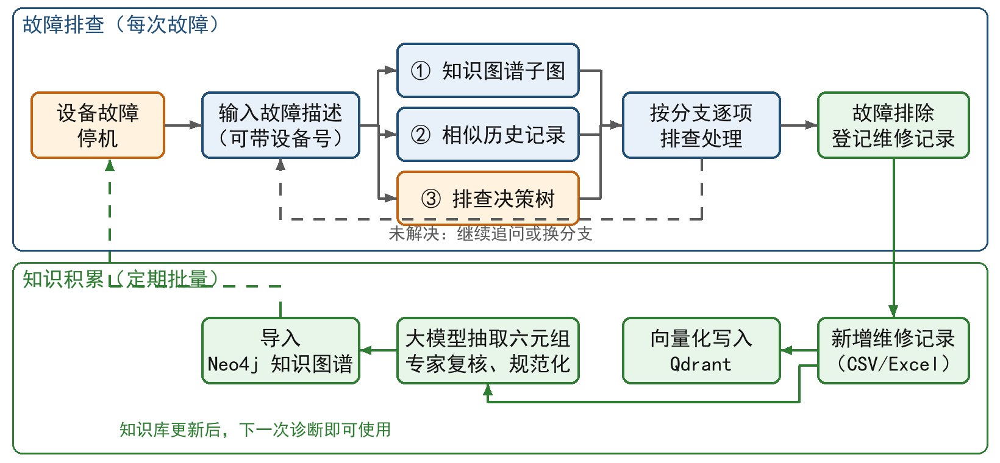
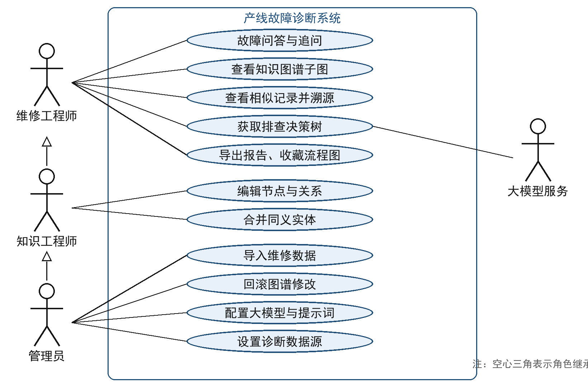

<!-- 草稿 v0.1（2026-11-11）。插图由 _build/make_figs_ch34.py 生成。数字均来自 data/ 下实验结果或代码事实核对。 -->

# 第3章 需求分析

## 3.1 业务现状与问题

某汽车零部件企业机加工车间有加工中心、清洗机、机械手等设备约一百台，分布在三个生产区域。设备发生故障时，维修工程师到现场查看报警和故障现象，凭经验判断故障部位和原因，再逐项排查、处理，处理完成后把故障现象、原因和处理措施登记到维修记录表中。2023—2025年共积累维修记录15319条。

现有做法存在以下问题：

（1）排查依赖个人经验。经验丰富的工程师能较快锁定原因，新员工往往需要反复试错，停机时间长。

（2）历史记录难以利用。维修记录是口语化的短文本，同一部件、同一故障有多种写法（如“刀库门”“刀库防护门”），在表格中只能按关键词查找，查不全，也看不出“设备—部件—故障—原因—措施”之间的对应关系。

（3）查到的记录需要人工归纳。即使找到十几条相似记录，工程师仍要自己总结有哪些可能原因、先查哪个后查哪个。

（4）现场网络不稳定。车间部分区域网络信号差，依赖外部服务的工具在断网时无法使用。

## 3.2 业务流程分析

引入系统后的故障排查流程如图3-1所示：工程师在系统中输入故障描述（可带设备编号），系统依次返回相关的知识图谱子图、相似历史记录和排查决策树；工程师按决策树逐个分支排查，必要时继续追问；故障处理后，新的维修记录由管理员定期导入，经抽取、复核后补充进知识图谱和向量库，形成“使用—积累—再使用”的闭环。

图3-1 引入系统后的故障排查业务流程

## 3.3 用户角色

根据系统的使用方式，用户分为三类：

（1）维修工程师（只读用户）：系统的主要使用者，输入故障描述获得诊断结果，查看知识图谱和相似记录，按排查决策树处理故障，可以追问、导出报告、收藏流程图。

（2）知识工程师：在维修工程师权限之外，负责维护知识图谱，修改错误的节点和关系，合并同义实体。

（3）管理员：在知识工程师权限之外，负责导入维修数据、回滚错误的图谱修改、配置大模型和提示词、设置诊断数据源开关。

此外，系统还与两类外部对象交互：大模型服务（企业内部模型网关，或本地部署的开源模型），以及存放知识的图数据库和向量数据库。

系统用例如图3-2所示。

图3-2 系统用例图

## 3.4 功能需求

### 3.4.1 故障诊断

（1）故障问答：用户用自然语言描述故障，问句中可以带设备编号，也可以只写故障现象；支持中英文；同一会话中可以对诊断结果继续追问。

（2）知识图谱子图展示：识别问句中的设备和部件，返回相关的“区域—设备—部件—故障—原因—措施”链路，以图的形式展示；点击某个部件时，高亮这条维修记录对应的完整链路；节点可以追溯到来源维修记录。

（3）相似记录展示：列出与问句最相似的历史维修记录，显示工位、问题、原因、措施和相似度，每条记录可以追溯到来源文件和行号。

（4）排查决策树生成：综合知识图谱和相似记录，生成按原因分支的排查决策树，每个分支给出可能原因、处理步骤和依据；分支按处理成本由低到高排列，先查容易的、后查麻烦的。决策树中标明是由大模型生成还是由规则生成。

（5）分阶段返回：知识图谱和相似记录检索完成后立即显示，不必等待决策树生成。

（6）断网可用：无法连接大模型服务时，系统仍要给出排查决策树。

（7）结果保存与导出：诊断会话自动保存，可以查看和删除历史会话；排查流程图可以收藏到流程图库；诊断结果可以导出为PDF、Word或图片。

### 3.4.2 知识管理

（1）维修数据导入：导入CSV或Excel格式的维修记录，完成向量化并写入向量库；导入六元组链路表，写入知识图谱。

（2）知识图谱浏览：按区域、设备、部件、故障、原因、措施逐级筛选浏览，查看节点数、关系数等统计信息。

（3）知识图谱编辑：修改节点名称和属性，增删关系，把同义的节点合并为一个。

（4）修改回滚：每次修改都记录日志，可以撤销单次修改或整组修改。

### 3.4.3 系统配置

（1）大模型配置：选择大模型服务类型，填写服务地址、密钥和模型名称，并能测试连接。

（2）提示词管理：在线修改各环节使用的提示词，保留历史版本，可以恢复到旧版本或默认版本。

（3）诊断数据源配置：可以分别开关知识图谱、相似记录和精排，选择决策树生成方式（自动或只用规则），并提供“模拟断网”开关。这组开关既用于现场按需调整，也用于第6章的消融实验。

（4）界面语言：支持中文和英文切换。

## 3.5 非功能需求

（1）响应时间：检索阶段（知识图谱和相似记录）应在2秒内返回；大模型生成决策树受外部服务影响，一般应在1分钟内完成，并设置超时，超时后改用规则决策树；无网络时整个诊断应在数秒内完成。

（2）数据安全：系统部署在企业内网，维修数据、知识图谱和向量库都保存在本地；大模型只调用企业内部的模型服务，生产数据不出内网；论文、截图和演示中使用脱敏数据。

（3）可追溯性：知识图谱中的每条关系、表格中的每条记录都要能追溯到原始维修记录，便于工程师判断结论是否可信。

（4）可靠性：大模型调用失败、超时或输出不符合格式时，系统自动改用规则决策树，保证始终有可用结果。

（5）可维护性：数据源开关、大模型和提示词都可在界面上配置，修改后下一次提问即生效，不需要改代码或重启服务。

（6）易用性：界面简洁，现场工程师无需培训即可使用；支持在普通办公电脑的浏览器中访问。

## 3.6 可行性分析

（1）技术可行性：系统用到的Neo4j、Qdrant、BGE-M3、FastAPI、React等都是成熟的开源技术；大模型通过与OpenAI兼容的接口调用，可以对接企业已有的模型服务，也可以换成本地部署的开源模型。

（2）数据可行性：已获得2023—2025年的15319条真实维修记录，其中2023年的5455条已完成六元组抽取和专家复核，知识图谱和向量库均已建立。

（3）经济可行性：所用软件均为开源软件，图数据库、向量数据库和嵌入模型可在普通工作站（本文实验环境为7.3 GB内存的笔记本电脑）上运行，大模型使用企业已有服务，不需要额外购买显卡等硬件。

（4）操作可行性：系统通过浏览器访问，输入方式与日常搜索一致，现场工程师容易上手。

## 3.7 本章小结

本章分析了车间设备维修的现状和问题，梳理了引入系统后的业务流程，确定了维修工程师、知识工程师和管理员三类用户，从故障诊断、知识管理和系统配置三方面提出了功能需求，并给出了响应时间、数据安全、可追溯性等非功能需求，最后从技术、数据、经济和操作四个方面论证了可行性。
