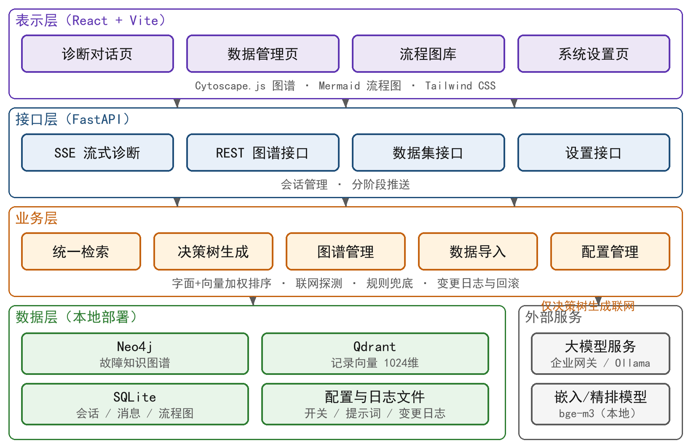
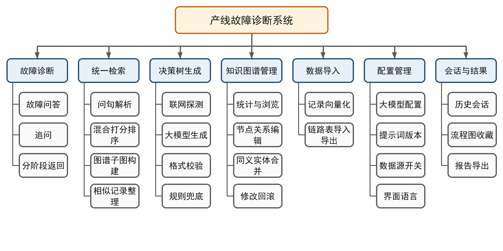
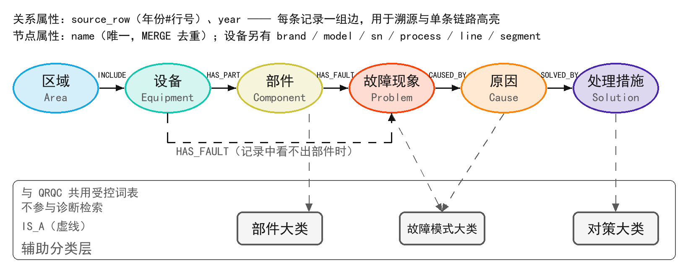
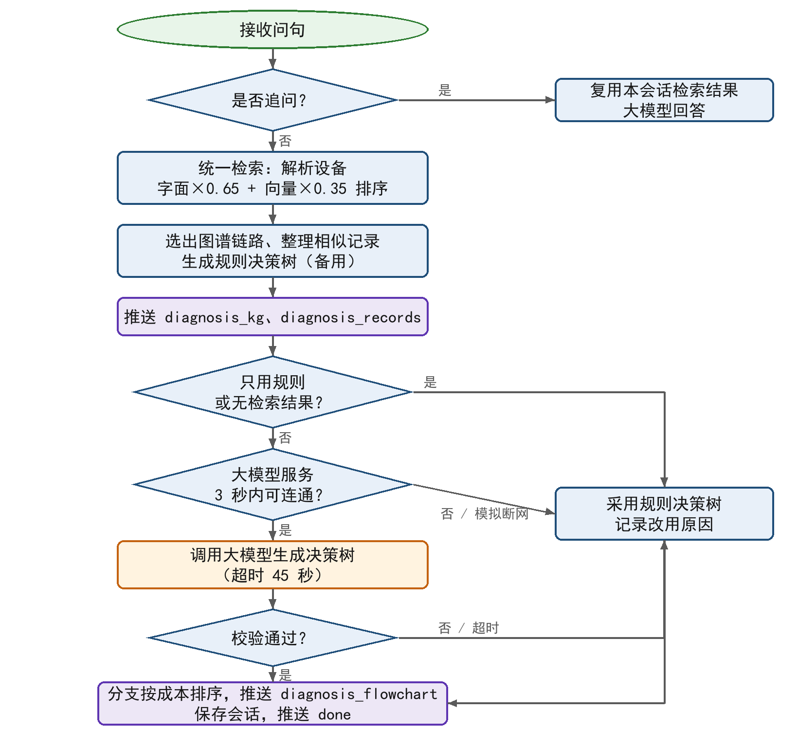

<!-- 草稿 v0.1（2026-11-11）。事实来源：论文/_代码事实核对_2026-11-11.md；图谱规模为 2026-11-11 实测（_eval_cache/_kgstats.py）。插图由 _build/make_figs_ch34.py 生成。 -->

# 第4章 总体设计

## 4.1 设计原则

根据第3章的需求，系统设计遵循以下原则：

（1）本地优先：知识图谱、向量库、嵌入模型都部署在本地，检索不依赖外网；只有决策树生成调用大模型。

（2）结果可降级：大模型不可用时，用规则生成同样格式的决策树，保证诊断始终有结果。

（3）证据可追溯：图谱中的每条关系和表格中的每条记录都带有来源记录编号。

（4）检索结果共用：一次检索得到的同一批候选记录，同时用于图谱展示、记录表和决策树生成，三处结果彼此一致。

（5）配置与代码分离：数据源开关、大模型和提示词都保存在配置文件中，在界面上修改后下一次提问即生效。

## 4.2 系统架构

系统采用前后端分离的B/S架构，分为四层（图4-1）：

（1）表示层：基于React的单页应用，包括诊断对话、数据管理、流程图库、系统设置等页面，通过HTTP与后端通信，诊断结果通过SSE流式接收。

（2）接口层：FastAPI提供的REST接口和SSE流式接口，负责请求解析、会话管理和结果推送。

（3）业务层：包括统一检索模块、决策树生成模块、知识图谱管理模块、数据导入模块和配置管理模块。

（4）数据层：Neo4j保存故障知识图谱，Qdrant保存维修记录向量，SQLite保存会话、消息和收藏的流程图，配置和图谱修改日志以文件形式保存。外部的大模型服务通过OpenAI兼容接口接入，可以是企业内部的模型网关，也可以是本地Ollama服务。

图4-1 系统总体架构

## 4.3 功能模块设计

系统功能模块如图4-2所示。

图4-2 系统功能模块

（1）故障诊断模块：接收问句，判断是新问题还是追问。新问题依次完成问句解析、统一检索、图谱子图构建、相似记录整理和决策树生成，按阶段把结果推送给前端；追问则基于本会话已有的检索结果由大模型回答。

（2）统一检索模块：识别问句中的设备、区域和品牌，缩小候选范围；对候选记录计算字面覆盖度和向量相似度并加权排序（可选交叉编码器精排）；从排序结果中选出节点名与问句对得上的链路构成图谱子图，同时生成相似记录表和规则决策树。

（3）决策树生成模块：先探测大模型服务能否连通。连通时把图谱链路和前6条相似记录组织成证据，按提示词要求大模型输出JSON格式的决策树，校验通过后按成本等级排序分支；不连通、调用超时或输出不合格时，改用规则决策树。

（4）知识图谱管理模块：提供图谱统计、逐级浏览、节点和关系的增删改、同义节点合并；每次修改写入变更日志并记录逆操作，用于回滚。

（5）数据导入模块：把CSV或Excel格式的维修记录向量化后写入Qdrant；导入、导出六元组链路表，写入或导出Neo4j。

（6）配置管理模块：管理大模型连接参数、提示词及其历史版本、诊断数据源开关和界面语言。

（7）会话与结果管理模块：保存会话和消息，支持历史会话的查看和删除、流程图收藏和诊断报告导出。

## 4.4 故障知识图谱本体设计

### 4.4.1 实体与关系

根据维修记录的结构和排查业务的逻辑，设计了包含六类实体、五类关系的故障本体（图4-3，表4-1、表4-2）。

图4-3 故障知识图谱本体

表4-1 故障知识图谱的实体类型

| 实体类型 | 标签 | 含义 | 来源 | 示例 |
|---|---|---|---|---|
| 区域 | Area | 生产区域 | 记录字段 | 机加区A |
| 设备 | Equipment | 设备（工位） | 记录字段 | EQ-001 |
| 部件 | Component | 发生故障的部件 | 大模型抽取 | 刀库门 |
| 故障现象 | Problem | 故障的表现 | 大模型抽取 | 刀库门打不开 |
| 原因 | Cause | 导致故障的原因 | 大模型抽取 | 气缸漏气 |
| 处理措施 | Solution | 最终有效的处理动作 | 大模型抽取 | 更换气缸 |

表4-2 故障知识图谱的关系类型

| 关系 | 起点 → 终点 | 含义 |
|---|---|---|
| INCLUDE | 区域 → 设备 | 区域包含设备 |
| HAS_PART | 设备 → 部件 | 设备有某部件（故障） |
| HAS_FAULT | 部件 → 故障现象 | 部件出现某故障；原始记录看不出部件时由设备直接指向故障现象 |
| CAUSED_BY | 故障现象 → 原因 | 故障由某原因引起 |
| SOLVED_BY | 原因 → 处理措施 | 原因用某措施处理 |

一条维修记录对应一条“区域—设备—部件—故障现象—原因—处理措施”链路，即一个六元组。

### 4.4.2 溯源属性与节点共享

所有节点以名称（name）作为唯一标识，导入时用MERGE去重，同名实体共用一个节点，因此不同记录中相同的部件、故障会汇聚到同一节点上，便于看出“同一故障有哪些不同原因”。但节点共享后，仅从图结构上无法区分哪条边属于哪条记录。为此，在每条关系上保存来源属性`source_row`（格式为“年份#行号”）和`year`，并把`source_row`作为关系唯一性的一部分：每条维修记录在链路上各有一组自己的边，同一对节点之间可以有多条来自不同记录的平行边。返回给前端时，平行边合并为一条显示，边上带所有来源编号的列表。前端点击部件时，沿来源编号相同的边遍历，就能只高亮属于同一条维修记录的完整链路；记录表中的每条记录也可以通过同一编号回到原始数据。

设备节点上另外保存台账属性（品牌、型号、序列号、工序、产线、区段），悬浮查看设备节点时显示。

### 4.4.3 辅助分类层

为了与企业的质量问题管理（QRQC）系统共用一套受控词表，图谱中另外增加了一层分类节点：部件大类（PartClass）、故障模式大类（FailureMode）和对策大类（Countermeasure），具体的部件、故障现象/原因、处理措施通过IS_A关系挂到对应大类上，大类之间用SUBCLASS_OF表示层级。这一层只是附加的索引，不改动六元组链路，诊断检索不依赖它。

### 4.4.4 图谱规模

当前图谱由2023年经专家复核的5454条六元组构建，规模如表4-3所示（2026年11月11日统计）。

表4-3 故障知识图谱规模

| 类型 | 数量 | 类型 | 数量 |
|---|---|---|---|
| 区域 Area | 3 | 链路关系（5类）合计 | 21919 |
| 设备 Equipment | 99 | 其中 INCLUDE | 103 |
| 部件 Component | 775 | HAS_PART / HAS_FAULT / CAUSED_BY / SOLVED_BY | 各 5454 |
| 故障现象 Problem | 1717 | 分类关系 IS_A | 6891 |
| 原因 Cause | 1482 | 分类关系 SUBCLASS_OF | 5 |
| 处理措施 Solution | 2917 | 分类节点（PartClass 40、FailureMode 29、Countermeasure 13） | 82 |
| 六元组实体节点合计 | 6993 | 全部节点 / 全部关系 | 7075 / 28815 |

## 4.5 数据存储设计

### 4.5.1 向量库设计

每条维修记录在Qdrant中存为一个点：向量为BGE-M3对记录文本编码得到的1024维稠密向量，距离度量为余弦相似度；负载字段见表4-4。按年份和数据批次分为多个集合，检索时可在设置中选择启用哪些集合。检索时用station字段过滤，只在问句识别出的设备的记录中检索。

表4-4 向量库负载字段

| 字段 | 含义 |
|---|---|
| record_id | 记录编号 |
| line / station | 区域（产线）/ 设备（工位） |
| problem / cause / action | 故障现象 / 原因 / 处理措施 |
| plan | 后续计划 |
| date | 日期 |
| source_year / source_row / source_file | 来源年份 / 来源行号 / 来源文件，与图谱的 source_row 对应 |
| source_row_hash | 记录内容摘要，用于去重 |

### 4.5.2 关系数据库设计

会话、消息和收藏的流程图保存在SQLite中，表结构见表4-5至表4-7。

表4-5 会话表 conversations

| 字段 | 类型 | 说明 |
|---|---|---|
| conversation_id | TEXT，主键 | 会话编号 |
| title | TEXT | 会话标题（取第一个问句） |
| message_count | INTEGER，默认 0 | 消息数 |
| last_activity | TEXT（ISO 时间），非空 | 最后活动时间 |
| created_at | TEXT（ISO 时间），非空 | 创建时间 |

表4-6 消息表 messages

| 字段 | 类型 | 说明 |
|---|---|---|
| id | INTEGER，主键，自增 | 消息编号 |
| conversation_id | TEXT，外键（级联删除），建索引 | 所属会话 |
| role | TEXT | user / assistant |
| content | TEXT | 消息文本 |
| timestamp | TEXT（ISO 时间） | 时间 |
| qdrant_records | TEXT（JSON） | 本轮检索到的相似记录，供追问时复用 |
| extra_payload | TEXT（JSON） | 图谱子图、决策树等结构化结果 |

表4-7 流程图收藏表 flowcharts

| 字段 | 类型 | 说明 |
|---|---|---|
| id | TEXT，主键 | 编号 |
| title / query | TEXT | 标题 / 原始问句 |
| mermaid_code | TEXT | 流程图的 Mermaid 描述 |
| flow_plan | TEXT（JSON） | 决策树结构 |
| records | TEXT（JSON） | 生成时依据的记录 |
| created_at | TEXT（ISO 时间） | 收藏时间 |

SQLite没有专门的日期类型，时间以ISO 8601格式的文本保存；JSON字段同样以文本保存。

### 4.5.3 配置与日志文件

（1）诊断数据源配置`diagnosis_config.json`：use_kg（知识图谱）、use_vector（相似记录）、use_rerank（精排，默认关闭）、flow_generator（auto/rule）、simulate_offline（模拟断网）。

（2）提示词配置`prompts_config.json`，每次保存时在`prompts_history/`中留存历史版本。

（3）图谱变更日志`graph_mutations.jsonl`：每行一次修改，记录编号、时间、操作类型、操作对象、请求内容和逆操作。回滚时执行逆操作，逆操作分为删除节点、恢复节点状态、重建节点、删除关系、重建关系五种；同一次用户操作产生的多条修改共用一个组编号，可以整组回滚。

## 4.6 诊断流程设计

一次新问题的诊断流程如图4-4所示：

1. 接收问句，判断是否为追问；英文问句先翻译为中文。
2. 统一检索：解析问句中的设备、区域、品牌；在候选记录上计算字面覆盖度和向量相似度，按0.65:0.35加权排序；选出与问句对得上的图谱链路，整理相似记录，并生成规则决策树。
3. 推送知识图谱子图（diagnosis_kg）和相似记录（diagnosis_records），前端立即显示。
4. 决策树生成：若配置为只用规则或没有检索结果，直接采用规则决策树；否则探测大模型服务（3秒内能否建立TCP连接，结果缓存30秒；“模拟断网”开关打开时直接判为不连通）。连通时调用大模型生成决策树（超时45秒），校验通过则按成本等级排序分支；不连通、超时或输出不合格时采用规则决策树，并记录原因。
5. 推送决策树（diagnosis_flowchart），结果中带生成方式（大模型/规则）和改用规则的原因；保存会话后推送结束标志（done）。

图4-4 诊断流程

## 4.7 接口设计

后端主要接口见表4-8。

表4-8 主要接口

| 分类 | 方法与路径 | 说明 |
|---|---|---|
| 诊断 | POST /chat | 诊断对话，SSE 流式返回 |
| 会话 | GET /conversations；GET /conversations/{id}/messages；DELETE /conversations/{id} | 会话列表、消息、删除 |
| 图谱查询 | GET /graph/overview、/graph/search、/graph/neighbors | 图谱浏览与检索 |
| 图谱编辑 | POST /graph/node；PUT、DELETE /graph/node/{id}；POST /graph/node/merge；POST /graph/edge；DELETE /graph/edge/{id} | 节点、关系的增删改与合并 |
| 回滚 | GET /graph/mutations；POST /graph/mutations/{id}/rollback；POST /graph/mutations/{group_id}/rollback-group | 修改日志与回滚 |
| 图谱导入导出 | GET /graph/export-csv；POST /graph/import-csv | 六元组链路表 |
| 数据集 | POST /api/datasets/embed；GET /api/datasets/collections 等 | 记录向量化与集合管理 |
| 流程图 | GET、POST /flowcharts；GET、DELETE /flowcharts/{id} | 流程图收藏 |
| 设置 | GET、POST /settings/diagnosis、/settings/prompts、/settings/llm；POST /settings/llm/test | 配置管理 |

SSE接口每一帧为一个JSON对象，用type字段区分内容，主要类型见表4-9。

表4-9 诊断接口的推送帧类型

| type | 内容 |
|---|---|
| meta | 会话编号等元信息 |
| progress | 处理进度提示 |
| diagnosis_kg | 知识图谱子图（节点、边、来源编号） |
| diagnosis_records | 相似记录列表 |
| diagnosis_flowchart | 决策树（结构、生成方式、改用规则的原因） |
| content | 文本回答（追问时） |
| done / error | 结束 / 出错 |

## 4.8 本章小结

本章给出了系统的总体设计：采用四层B/S架构，划分了故障诊断、统一检索、决策树生成、知识图谱管理、数据导入、配置管理和会话管理七个模块；设计了六类实体、五类关系的故障本体，用关系上的来源编号实现节点共享下的单条链路溯源；设计了向量库、关系数据库和配置日志文件的存储结构；给出了诊断流程和接口设计。下一章介绍关键技术的实现。
