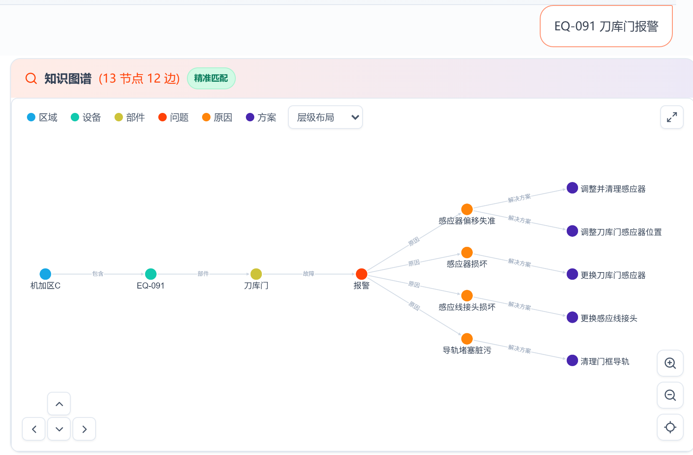
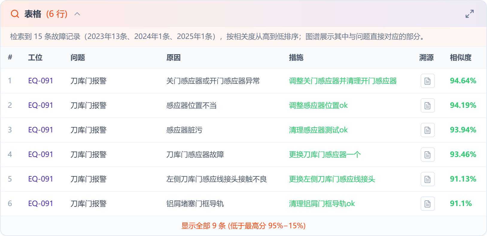
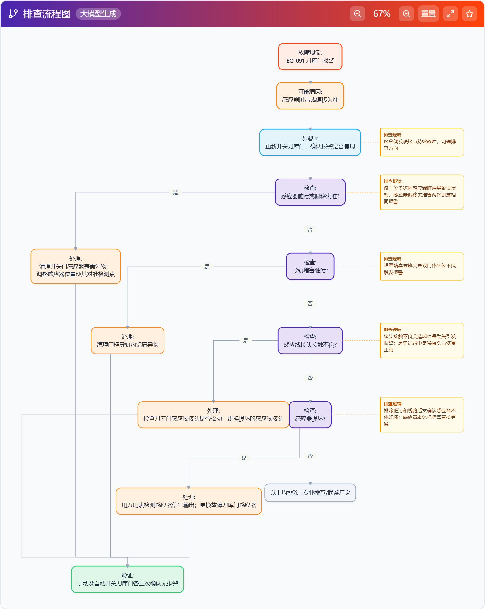
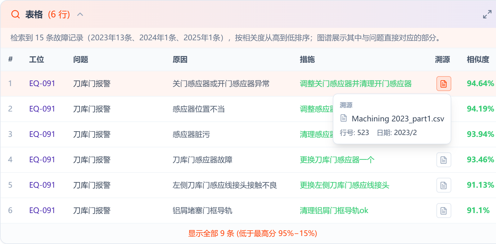
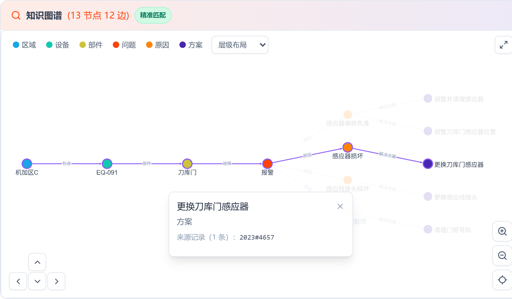
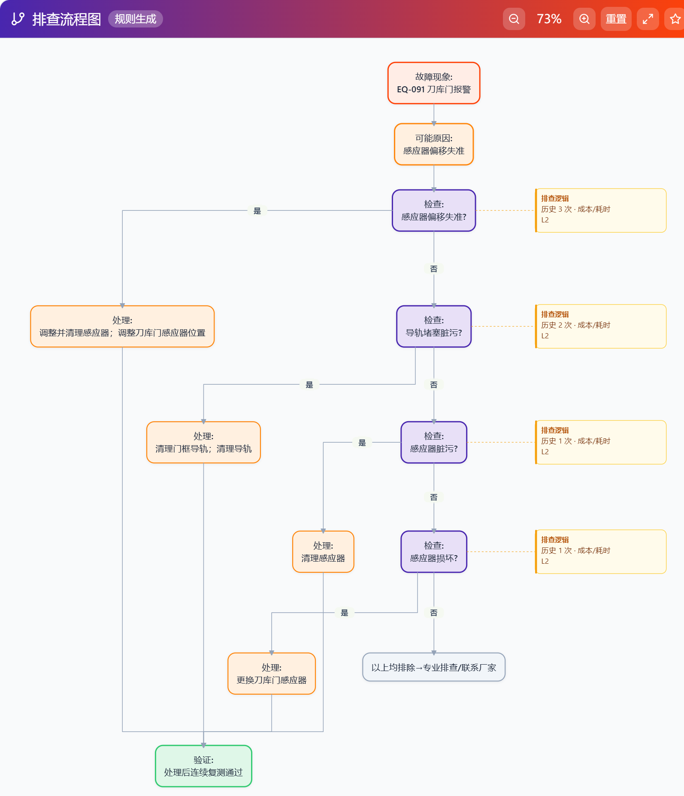

<!-- 草稿 v0.1（2026-11-11）。事实来源：fault_-ai_-project thesis 分支（6748d66）；_qc_2023.txt；_merge_changes23.csv。代码行号见“_代码事实核对”。界面截图（图5-1～图5-5）为 2026-11-12 用脱敏显示截取，原图在 fault_-ai_-project/_private/screenshots_raw。 -->

# 第5章 关键技术与实现

本章介绍系统中几项关键技术的具体实现：维修记录预处理与六元组抽取、图谱规范化与入库、统一检索、排查决策树生成，以及前端的分阶段展示与链路高亮。

## 5.1 维修记录预处理

原始维修记录来自车间2023—2025年的三个Excel/CSV台账，共15319条（2023年5455条、2024年5248条、2025年4616条）。三年的表格列名、编码不完全一致（2024、2025年为GBK编码），预处理包括：

（1）字段映射：统一为区域（line）、设备（station）、故障现象（problem）、故障原因（cause）、处理措施（action）、后续计划（plan）、日期（date）等字段，并为每条记录生成来源编号`source_row`（年份#行号），后续图谱、向量库和界面都用这个编号互相对应。

（2）设备编号归一化：同一台设备有“PM18-A/B1”“PM18-AB1”等写法，比较时去掉空格、横线、斜杠、井号并转为大写。

（3）脱敏：为论文和演示单独生成脱敏数据，设备编号按区域顺序替换为EQ-001等代号，区域替换为“机加区A/B/C”，人名删除，日期精确到月，设备品牌替换为“品牌X”；映射表只保存在本地，不随代码和论文外传。

## 5.2 基于大模型的六元组抽取

### 5.2.1 抽取提示词设计

区域和设备直接从记录字段复制，部件、故障现象、原因和处理措施由大模型从“故障现象描述”“解决对策”“故障原因”三列文本中抽取。提示词采用“字段定义 + 难例规则 + 输出约束”的结构：

（1）字段定义与长度限制：故障现象不超过10个汉字，只保留核心现象；原因不超过8个汉字，写成“部件+失效模式”（如磨损、松动、堵塞）；处理措施不超过12个汉字，只保留一个关键动作，去掉排查、测试确认、备件来源等过程。要求故障现象与原因不能同义——现象是“看到的”，原因是“为什么”。

（2）部件抽取的优先顺序：故障描述中出现部件名词时优先取描述中的部件；描述中只有现象词（漏气、报警）时，才从处理措施中取被维修的部件；两者都没有时，填“设备_故障描述”。

（3）难例规则：动作词和工序词（换刀、移动、定位等）不能作为部件；“拆钣金、装钣金”只是维修过程，不是故障部件，应取真正被更换或调整的部件；报警码类故障取报警码对应的轴号；不能只返回站号。

（4）输出约束：只输出包含四个字段的JSON，所有字段不能为空，采样温度为0。

模型输出后，程序提取回复中的第一个完整JSON对象；部件为空或只有站号时，附加“上次返回了空或纯站号，必须取真正的部件名”的提示重试一次；仍失败时，用约80个常见部件名组成的词表从描述和对策中匹配部件兜底。

### 5.2.2 规则校验与专家复核

抽取完成后，用规则检查空值、字段超长、“故障现象与原因完全相同”、部件只有站号等问题。2023年5455条记录中，5454条抽取成功，1条用词表兜底；各字段无空值；部件采用“设备_故障描述”格式的有37条，故障现象与原因完全相同的有36条，均列入复核清单。随后由维修专家逐条复核并修正，复核后的六元组作为构建图谱的依据。抽取质量的人工抽检结果见第6章。

## 5.3 图谱规范化与入库

### 5.3.1 实体规范化

抽取结果中同一实体常有不同写法，例如“丝杠异响”与“Y轴丝杠异响”、“报警撞击”与“报警撞机”，若不处理，会在图谱中形成大量只连一条记录的孤立节点，同一故障的不同原因也无法汇聚到一起。规范化分两步：先用规则处理确定性的情况（错别字、轴号缺失、括号和空格差异等），再把同一部件下名称相近的候选交给大模型判断是否同义，并结合上下文（同一部件）给出统一名称。所有修改都记录到变更清单中，包括来源编号、字段、原值、新值、上下文和依据，便于审核和撤销。2023年数据共产生1258处修改，其中故障现象931处、处理措施176处、原因151处；依据为大模型判断的1202处，规则判断的54处，人工确认的2处。

### 5.3.2 导入Neo4j

规范化后的六元组按“区域—设备—部件—故障现象—原因—处理措施”导入Neo4j。节点用MERGE按名称去重，同名实体共用一个节点；关系则把来源编号`source_row`作为MERGE的一部分，每条记录生成自己的一组边，年份记入`year`属性。以部件到故障现象一段为例：

```cypher
MERGE (c:Component {name: $c})
MERGE (p:Problem {name: $p})
WITH c, p
MERGE (c)-[r:HAS_FAULT {source_row: $src}]->(p)
SET r.year = $year
```

这样重复导入同一条记录不会产生重复的边，而不同记录在同一对节点之间各有一条边，关系总数等于记录数（HAS_PART、HAS_FAULT、CAUSED_BY、SOLVED_BY各为5454条，表 4.3）。设备到区域的INCLUDE关系不区分记录，每台设备只有一条。

<!-- 导入语句见 server.py:5570-5611（/graph/import-csv）。 -->

导入后，图谱规模见表4-3。

## 5.4 统一检索的实现

统一检索模块（`unified_retrieval.py`）在系统启动时把三年的全部记录（15319条）与图谱链路（5454条）按来源编号合并成一个内存索引，每次检索只做一次打分排序，得到的同一批候选同时用于图谱、记录表和规则决策树。

### 5.4.1 问句解析

问句解析依次识别设备、区域和品牌：

（1）设备：把问句归一化后，按长度从长到短与设备词典（来自图谱设备节点和原始记录的工位字段）匹配，长编号优先；匹配位置后紧跟数字时视为未命中，避免“EM21-B1”误命中“EM21-B12”。

（2）区域和品牌：在去掉设备号后的剩余文本中，按整词匹配区域名和设备台账中的品牌。

（3）剩余文本：去掉设备号、区域、品牌以及“是什么原因”“怎么办”等疑问尾巴和标点后，剩下的部分作为故障描述，用于后续打分。

识别出设备时，只在该设备的记录中检索；未识别设备但识别出品牌或区域时，在对应设备集合中检索。该步骤纯属字符串处理，实测耗时不到1毫秒（第6章）。

### 5.4.2 混合打分

对候选记录分别计算字面分和向量分：

（1）字面分。中文按相邻两个字切成二元字组，英文和数字按整词切分，不需要分词词表。定义覆盖度为集合A中有多少（按IDF加权）出现在集合B中：

$$\mathrm{cov}(A,B) = \frac{\sum_{g\in A\cap B}\mathrm{idf}(g)}{\sum_{g\in A}\mathrm{idf}(g)} \tag{5-1}$$

其中IDF用全部记录统计，采用平滑形式 idf(g)=ln((N+1)/(n_g+1))+1。设问句故障描述的字组集合为Q，记录的“部件+故障名+原始现象”字组集合为D，记录的简短名称（部件+故障名）字组集合为S，字面分为

$$s_{\mathrm{lex}} = 0.7\,\mathrm{cov}(Q,D) + 0.3\,\mathrm{cov}(S,Q) \tag{5-2}$$

前一项衡量问句被记录覆盖了多少（召回），后一项衡量记录的简短名称被问句覆盖了多少（精度），防止只因记录文本长、碰巧包含问句中的字而得高分。

（2）向量分。用BGE-M3编码问句，在Qdrant中按设备过滤后取最相近的记录，余弦相似度为v。由于BGE-M3在本数据上的余弦值大多落在0.45～0.85之间，先线性映射到[0,1]：

$$s_{\mathrm{vec}} = \min\left(1,\max\left(0,\frac{v-0.45}{0.4}\right)\right) \tag{5-3}$$

（3）综合分按分数加权融合（第2.3.1节）计算：

$$s = 0.65\,s_{\mathrm{lex}} + 0.35\,s_{\mathrm{vec}} \tag{5-4}$$

向量服务不可用时只用字面分。按综合分降序排序后，以 max(0.25, 0.4×最高分) 为阈值截断，取前15条作为相似记录；另外从全部候选中单独取前40条带图谱链路的记录作为图谱候选，因为只有2023年的记录有链路，若只从前15条中挑选，会被2024、2025年的记录挤掉。权重0.65与其他融合方式的对比见第6章。

（4）可选精排。设置中打开“精排”后，用bge-reranker对召回结果重排序。实验发现问句与记录的输入格式不对齐会使精排降低命中率，因此精排的输入改为“问句去掉设备号”对“部件+故障名+现象”；由于对齐后精排也没有提升命中率，且每次增加约5秒，系统默认关闭精排（第6章）。

（5）实验屏蔽。做留一法实验时，通过环境变量`EVAL_EXCLUDE_SRC`指定测试记录的来源编号，检索时把该记录及其图谱链路从候选中剔除，防止大模型“看着答案作答”。该开关只在实验脚本中设置，正常使用时不生效。

### 5.4.3 图谱子图的选取

图谱候选中并非每条链路都适合画出来：原始描述中顺带提到的部件（如“修刀库门时发现安全门松动”中的安全门）会让图谱变得杂乱。因此只画节点名与问句“整词对得上”的链路：问句中出现了完整的故障名时（如“刀库门报警”），只画该故障的链路，同一部件的“刀库门故障”“刀库门无信号”等其他故障不画；问句只点名了部件时，画该部件的链路；否则画故障名对得上的链路。“故障”“报警”这类泛化词单独出现时不算命中，但问句去掉这些词后的主体（如“Y轴故障”中的“Y轴”）出现在节点名中也算命中。选出的链路组装成节点和边：同一对节点之间来自不同记录的平行边合并为一条显示，边上带上它们的来源编号列表（source_rows），供前端高亮使用。

## 5.5 排查决策树生成

### 5.5.1 决策树的数据结构

无论由大模型还是规则生成，决策树都用同一种JSON结构描述（称为DSL），主要字段见表5-1。前端把它转换成Mermaid流程图描述后渲染。

表5-1 决策树DSL的主要字段

| 字段 | 含义 |
|---|---|
| problem | 故障问题（≤20字） |
| likely_cause | 最可能的原因 |
| mode | single：单一路径；by_cause：按原因分支 |
| steps | 通用前置检查步骤（check / action / why / evidence） |
| branches | 原因分支：cause，steps[{do, why}]，evidence（证据编号） |
| cause_summary | 原因—措施对照表 |
| tip / verify | 经验提示 / 处理后的验证条件 |
| generator / fallback_reason | 生成方式（llm / rule）/ 改用规则的原因 |

### 5.5.2 大模型生成

（1）证据组织。相似记录取前6条，每条写成一行“[编号] 工位、问题、原因、措施、日期、相似度、成本等级”，成本等级由5.5.4节的规则给出，让大模型的排序有据可依。图谱证据最初按类别列出（“原因：A|B|C；措施：X|Y|Z”），这种写法丢失了“哪个原因对应哪个措施”；改为每行一条“部件 → 故障 → 原因 → 措施”链路，相同链路合并并标注出现次数。

（2）提示词。提示词要求：只能使用证据中出现的部件和处理动作；每个分支必须注明依据的证据编号；证据对不上问句时如实说明，不要硬凑分支；按“与问题的吻合程度 + 出现次数”挑选原因；只输出JSON。旧版提示词中有一个写死的编码器示例，模型常照抄，新版删除了示例。新旧提示词在20条开发集上的对比见第6章6.x节，新版措施命中率提高15个百分点，无依据词比例降低10.6个百分点。

（3）调用与解析。通过OpenAI兼容接口调用，温度为0，超时45秒。返回内容先去掉Markdown代码块标记，再提取第一个JSON对象解析；各字段按长度截断，分支最多4个，每个分支最多3步。解析失败、或解析后既无步骤也无分支，视为输出无效。

（4）分支重排。大模型给出的分支顺序不一定稳定，系统不直接采用，而是用5.5.4节的规则为每个分支计算成本等级后按等级升序重排（同级保持大模型的原顺序），原因—措施对照表随之同序。这样，“先查省钱省时的原因”由确定的规则保证，同一输入的分支顺序可复现。

### 5.5.3 规则生成与降级

规则决策树不调用大模型，在检索阶段就已生成，作为备用：

1. 把检索到的记录按原因分组，图谱记录用原因节点名，没有链路的记录取原始原因文本的第一句（不超过16字）；“未找到原因”“交接”等无效原因跳过。
2. 每组累计相关度之和w（各记录综合分之和），即“相关度×出现次数”，取w最大的前4组作为分支。
3. 每个分支取该原因下出现最多的两种处理措施作为处理步骤，并注明“历史N次·成本/耗时等级L”。
4. 分支按成本等级升序排列，同级按出现次数降序。

决策树生成入口按以下顺序决定生成方式：配置为“只用规则”或没有检索结果时，直接采用规则决策树；否则探测大模型服务——对服务地址建立TCP连接，3秒内连通视为在线，结果缓存30秒，避免每次提问都探测；“模拟断网”开关打开时直接视为离线。在线时调用大模型，出现网络异常、超时或输出无效时，改用规则决策树，并在结果中记录原因（如“无网络”“大模型输出无效（ValueError: …）”），前端悬停在“规则生成”标识上即可看到。

### 5.5.4 成本等级的确定

成本等级用关键词规则从处理措施和原因文本中推断，分成本和耗时两个维度，各分5级（表5-2）。一段文本命中多个等级时取最高级，因为一条记录最终若要“更换电机”，其成本应按更换计算，而不是按其中的“检查”步骤计算；没有命中任何关键词时取2级。综合等级为两者平均后四舍五入。为避免型号插在动词中间导致漏配（“更换C32编码器”不含“更换编码器”），评分前先去掉型号和工位编号。

表5-2 成本与耗时等级（部分关键词）

| 等级 | 成本关键词 | 耗时关键词 |
|---|---|---|
| 1 | 目视、检查、紧固、复位、重启、清洁、调整参数 | 目视、确认、复位、重启、紧固、插紧 |
| 2 | 焊接、接线、润滑、加油 | 清洁、清理、吹扫、接线、润滑、调整 |
| 3 | 更换传感器/感应器/编码器、打磨 | 焊接、更换小件、打磨 |
| 4 | 更换轴承/油封/主轴、拆装 | 更换轴承/油封、拆装 |
| 5 | 更换电机/齿轮箱/减速机/总成、整机更换 | 更换总成/电机、等备件 |

## 5.6 前端实现

### 5.6.1 分阶段展示

前端用fetch读取SSE流，按帧的type字段分别更新三个区域：收到`diagnosis_kg`即渲染知识图谱，收到`diagnosis_records`即渲染相似记录表，收到`diagnosis_flowchart`再渲染决策树，决策树生成期间显示等待提示。这样用户在约2秒后就能看到图谱和记录（第6章E4），不必等待大模型。以问句“EQ-091 刀库门报警”为例，诊断页面如图5-1所示：上方是问句和知识图谱子图，中间是相似记录表，下方是排查决策树。







图5-1 诊断页面

相似记录表按综合分降序列出工位、问题、原因、措施和相似度，表头说明检索到的记录数及其年份分布；与最高分相差超过15个百分点的记录默认折叠，可点击“显示全部”展开。每条记录的“溯源”图标点开后显示该记录来自哪个数据文件的第几行以及日期（图5-2），工程师可据此回到原始台账核对。



图5-2 相似记录的溯源信息

### 5.6.2 知识图谱的单条链路高亮

图谱用Cytoscape.js绘制，节点按六类实体着色，默认采用层级布局，按“区域—设备—部件—故障现象—原因—处理措施”从左到右分层排列，也可切换为fcose力导向等布局。由于节点共享，同一个部件节点可能连着多条记录的链路。点击某个节点时，以该节点为起点做广度优先遍历，只沿边上`source_row`列表与当前链路有交集的边前进，从而只点亮属于同一条维修记录的完整链路，其余元素淡出；点击空白处恢复。选中节点时显示其关联的来源记录编号，有编辑权限的用户还可以编辑节点或把它合并到另一个节点。图5-3中点击的是方案节点“更换刀库门感应器”，只有来源记录2023#4657对应的“机加区C—EQ-091—刀库门—报警—感应器损坏—更换刀库门感应器”一条链路保持高亮。



图5-3 知识图谱的单条链路高亮

### 5.6.3 决策树渲染

前端把决策树DSL转换为Mermaid流程图描述：问题为起点，通用检查步骤依次相连，进入原因分支后每个分支一列，列出处理步骤，最后汇合到验证条件。标题栏显示“大模型生成”或“规则生成”标识，判断节点右侧的便签显示该步骤的排查理由。流程图可以缩放、全屏查看、收藏到流程图库，诊断结果可导出为PDF、Word或图片。

图5-1（c）是大模型生成的决策树，便签中的理由由大模型根据证据写出。对同一问句打开“模拟断网”后，得到的是规则决策树（图5-4）：标题栏显示“规则生成”，鼠标悬停可看到原因“无网络”；四个分支是按累计相关度选出的原因，便签注明各原因的历史出现次数和成本/耗时等级。两棵树相比，规则决策树的分支和处理措施都来自历史记录原文，缺少通用前置检查和具体的验证条件，但可以在毫秒级给出。



图5-4 规则生成的排查决策树（模拟断网）

### 5.6.4 诊断数据源配置

第5.5.3节的“只用规则”和“模拟断网”，以及知识图谱、相似记录、精排三个数据源开关，都集中在设置页的“诊断数据源”中（图5-5）。开关保存在后端的配置文件中，下一次提问即生效，不需要重启服务；第6章消融实验的各组条件也用这几个配置项定义。


图5-5 设置页中的诊断数据源开关

## 5.7 本章小结

本章介绍了系统关键技术的实现：用“字段定义 + 难例规则 + 输出约束”的提示词抽取六元组，经规则校验、专家复核和实体规范化后导入Neo4j，用关系上累积的来源编号实现溯源；统一检索在一次打分中综合二元字组字面覆盖度和向量相似度，同一批结果供图谱、记录表和决策树共用；决策树优先由大模型融合两路证据生成，分支顺序由确定的成本规则重排，大模型不可用时自动改用规则决策树；前端按阶段展示结果，并支持单条链路高亮。
